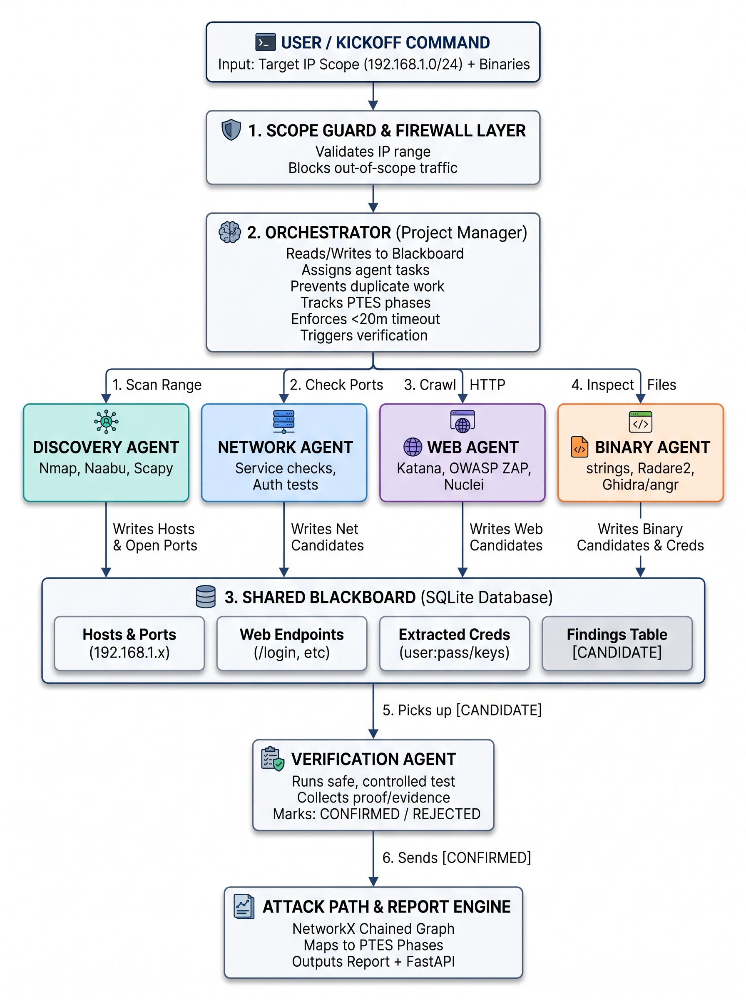

# MITIGATA

**Scope-enforced, multi-agent penetration-testing engine for authorised lab work.** One command discovers the
authorised range, inventories services, follows what the target itself names, analyses binaries, verifies each lead
with a control, maps every step to a PTES phase, and writes one report with the attack path. A local dashboard shows
the run, including the discovery chain (which step caused which).

The deterministic core decides. An optional LLM planner (DeepSeek) may only choose among candidates the target named.
Nothing is sent outside the manifest's ranges, and credential checks run only against the focus host(s).

Scope of this build: authorised lab testing only. See **Safety model** below.

## The problem

**CyberForge problem statement (PS):** Network Asset Discovery and Mapping: live map of every device and connection.

**Our elaborated problem statement:**

> The problem. Doing this by hand is slow and easy to get wrong. One engineer looks at one surface at a time. The web
> tester, the network scanner and the binary analyst do not share what they find, so the same host gets looked at three
> times, weaknesses get missed, and the full attack path is never seen. The work is hard to repeat and hard to trust.

## Our proposed solution

MITIGATA runs the chain from discovery to report from one kickoff. Every agent works from the same record of what has
been found.

1. **Scope guard and firewall.** Each target is checked against the authorised ranges before any packet is sent.
   Out-of-scope targets are refused and logged.
2. **Orchestrator.** Starts the agents, enforces the time budgets, avoids repeated work, tags each step with its PTES
   phase and hands leads to verification.
3. **Four agents on one blackboard.** The discovery agent finds live hosts and open ports. The network agent identifies
   services, reads banners and checks authentication surfaces. The web agent crawls, lists endpoints and follows the
   names the target itself prints. The binary agent triages supplied and downloaded binaries and recovers literals.
   All four write to one SQLite database, the blackboard, and read each other's results.
4. **Verification.** Each lead is tested with a control request beside it and ends as CONFIRMED, REJECTED or
   INCONCLUSIVE, with the oracle recorded.
5. **Attack path and report.** Confirmed steps are chained into a graph from the operator to an objective: authenticated
   access or a flag. The report (Markdown and JSON by default, HTML on request) gives the evidence and a plain-English
   fix for each finding.
6. **Dashboard.** A local page, on loopback, shows the run as it happens: stages, hosts, endpoints, binary output, the
   discovery chain, verdicts and the attack path.

The optional DeepSeek planner may only choose among candidates the target itself named. It cannot add a probe or confirm
a finding.

## What it solves

| The problem | What MITIGATA does | Where to see it |
|---|---|---|
| Slow and manual | One kickoff runs discovery, scanning, crawling, binary analysis, verification and the report, within time budgets (10 min for discovery and 25 min for a target scan by default) | Stepper and timeline on the dashboard; `mitigata hunt` on the command line |
| One engineer, one surface at a time | Four agents work on their own surface under one orchestrator and one set of budgets | Agent cards on the dashboard |
| Agents do not share what they find | Every host, service, endpoint, credential reference, lead and binary goes into one blackboard, and each agent reads what the others wrote | Shared blackboard panel |
| The same host is looked at three times | Each task has a dedup key, so the same work is not repeated, and each follow-up is linked to the step that caused it | Discovery chain panel |
| Weaknesses get missed | Follow-up probes from what the target says (hint paths), a forwarded-address trust test, binary literal recovery and an offline solver. Each lead is verified before it counts. | Binary agent output, findings and verification panels |
| The full attack path is never seen | The attack-path graph chains confirmed steps from the operator to an objective, each step tagged with its PTES phase | Attack path panel; report |
| Hard to repeat and hard to trust | Scope is checked before any socket opens. Each run records the manifest hash. Every verdict records its oracle, and its control where one was sent. Reports carry evidence and fixes. Secret values stay out of reports and the blackboard. | Run record; report files; dashboard |
| Live map of every device and connection (CyberForge PS) | Hosts, ports, services and endpoints appear as each stage finishes, and the discovery chain and attack path link each step to the step that caused it. Not built yet: a drawn network map of every device and every connection. | Dashboard; attack path |

## Architecture



**How data moves.** The kickoff (a target range and any binaries) goes through the scope guard to the orchestrator. The
orchestrator starts the four agents, which write findings to the blackboard. Verification picks up the candidates and
writes its verdicts back. The attack-path and report engine reads the confirmed results. The dashboard reads the
blackboard while the run is going.

**Design and build.** The diagram shows the design. The build differs in three places:

- Scanning uses nmap. Naabu and Scapy are in the diagram but not in the build.
- The web agent uses a built-in crawler and fuzzer, with katana and ffuf when they are installed. OWASP ZAP and Nuclei
  are in the diagram but not in the build.
- The blackboard stores credential references. Values are kept in a private file (mode 0600), not as user:pass pairs
  as the diagram suggests.

## Technologies and tools

| Layer | Tool or library | What it is used for |
|---|---|---|
| Language | Python 3.12, packaged with hatchling | All of the pipeline, the API and the command line |
| Discovery and port scans | nmap | Host discovery, the top-port scan, the full-range sweep, and service and version detection. TCP connect, so no root is needed. |
| Web crawl | Built-in same-origin crawler; katana (optional) | Pages, links and forms on web services. GET requests only. |
| Endpoint fuzzing | Built-in wordlist fuzzer; ffuf (optional) | Common paths from the vendored SecLists list, rate limited |
| Hint probes | Built-in extraction, with the SecLists list as the vocabulary | Names the target prints (for example a `/vault/` link), each requested once; state-changing names are excluded |
| Binary triage | radare2 6.2.4, pinned in the image | Strings, imports, functions, protections and disassembly of supplied binaries |
| Decompilation | Ghidra `analyzeHeadless` (optional) | C decompilation and the function list; radare2 is the fallback when Ghidra is missing |
| Solver | angr 9.2 (optional) | Offline emulation of a check that gates on stdout, to find an input that prints success. A candidate counts only after a concrete run confirms it. |
| HTTP client | Python standard library `http.client` | Requests made through the scope guard, so each one is checked first |
| Shared store | SQLite in WAL mode | The blackboard: assets, services, endpoints, credential references, leads, verdicts, tasks and events |
| Attack path | NetworkX | The directed graph from the operator to the objectives, with Mermaid output for the diagram |
| Verification | Python (`verifier.py`) | Control-based verdicts, and per-account attempt caps shared across runs through the engagement ledger |
| Dashboard and API | FastAPI and uvicorn; HTML, CSS and vanilla JavaScript | Loopback-only page and read API, with one token-protected write route and a strict Content-Security-Policy. No build step. |
| Models and config | Pydantic v2 and PyYAML | Validated run records and the YAML scope manifest |
| Optional planner | DeepSeek API (`deepseek-flash` by default) | Chooses among the target's own candidates. Never confirms a finding. |
| Packaging and deployment | Docker (python:3.12-slim-bookworm) and docker compose; uv for the local virtual environment | One image with nmap, radare2 and the optional solver. Host networking on Linux. |
| Tests | pytest and the FastAPI test client | Unit, end-to-end, API and loopback-chain tests, all on loopback |
| Standards and lists | PTES phases; SecLists common list (MIT, vendored) | Each step tagged with its PTES phase; the list drives hint and fuzz paths |

For the module map see [How the pipeline maps to the design](#how-the-pipeline-maps-to-the-design). For the gaps see
[What is built and what is not](#what-is-built-and-what-is-not).

## Quick start

### Local (Python 3.12, nmap, radare2 on PATH)

```bash
uv venv --python 3.12 .venv && uv pip install --python .venv/bin/python -e . pytest httpx   # once
.venv/bin/mitigata tools                                  # what is installed and what each agent falls back to
cp scope.example.yaml scope.yaml                          # then set the window, ranges and authorised_by
.venv/bin/mitigata serve --scope scope.yaml --out runs    # dashboard on http://127.0.0.1:8765/
```

The dashboard starts hunts itself: discover alive hosts, choose an IP, scan it. The CLI has the same steps:
`discover`, `target --ip ... --run <id>`, and the one-shot `hunt --focus <ip>`. `cmd.md` is the runbook.

`discover` exits `0` when the run is discovered. `target` exits `0` when complete, `4` when partial (gaps are listed in
the report), `3` when it refused before sending anything (closed window, out-of-scope IP), and `1` on failure.

### Docker

```bash
cp .env.example .env            # optional: DEEPSEEK_API_KEY, host uid/gid, scope file, solver on/off
mkdir -p runs binaries          # the container writes runs/ and reads binaries/
docker compose up --build       # dashboard on http://127.0.0.1:8765/ (host network, loopback only)
```

The image is Debian-slim with Python 3.12, nmap, and radare2 6.2.4 (the upstream `.deb`, pinned and SHA-256 checked).
`WITH_SOLVER=1` (the default) adds the optional angr solver; `WITH_SOLVER=0` gives a smaller image. Ghidra is not in the
image; the engine uses radare2 when Ghidra is absent. No secret is baked into the image; the key is passed at run time.

Host networking is Linux-only. On Docker Desktop, publish the port to the host's loopback and bind the container's
interfaces instead: `docker run -p 127.0.0.1:8765:8765 ... mitigata serve --host 0.0.0.0 ...`. The port stays on the
host's loopback, and the dashboard's Host check still applies.

## How the pipeline maps to the design

| Stage | Module | What it does |
|---|---|---|
| Scope guard | `pipeline/guard.py`, `scope.py` | Fail-closed allowlist and exclusions. Every connect asks the guard first; refusals are recorded. |
| Orchestrator | `pipeline/orchestrator.py` | Stages with deadline budgets, task dedup, PTES tags, lineage, and the only SQLite writer. |
| Discovery | `pipeline/scanner.py` | nmap host discovery (TCP connect), top ports, and a bounded full-range sweep of the focus host. |
| Network | `pipeline/net_agent.py` | Passive banner read before any input; passkey-protocol banners become leads. |
| Web | `pipeline/web_agent.py` | GET-only same-origin crawl; entry paths on the focus host; names the target prints (hints); forwarded-address trust test; binary links. |
| Follow-ups | `orchestrator.stage_followups` | Bounded probes derived from what earlier results said, each linked to the step that caused it. |
| Planner (optional) | `pipeline/planner.py` | DeepSeek selection among the target's own candidates. Off by default. |
| Binary | `pipeline/binary_agent.py`, `tools.py` | Static triage; Ghidra decompile or radare2 listings; literal recovery; the optional solver. |
| Solver (optional) | `pipeline/solver.py` | angr emulation of a stdout-gated check. A candidate counts only after a concrete emulated run prints success. |
| Verification | `pipeline/verifier.py` | Each lead has a control. Verdicts: CONFIRMED, REJECTED, INCONCLUSIVE, with the oracle recorded. |
| Attack path & report | `pipeline/attack_path.py`, `report.py` | Graph of the chain; Markdown, HTML and JSON reports with PTES tags and fixes. |
| Dashboard | `web/app.py`, `frontend/` | FastAPI on loopback. Panels: stepper, board, binaries with analysis status, discovery chain, verification, paths. |

## The discovery chain

Every step records the task that caused it (`tasks.parent_task_id`). The dashboard's **Discovery chain** panel draws
the tree, so you can see, for example: discover → inventory → identify → crawl → header test → content behind the
trusted address → binary → analysis → verification.

- **Hint probes.** Readable text from the target may name exposure words and paths (for example `/vault/`). Each name
  is requested once, at most 8 per service, and only when the word is also in the vendored SecLists list
  (`mitigata/wordlists/`, MIT). State-changing names are excluded.
- **Forwarded-address trust test (manifest-gated).** Some edge proxies trust a client-supplied address header. The test
  sends a control value from an address that is never trusted (an RFC 5737 documentation address), then candidates the
  target itself mentioned, plus the subnet gateway and loopback. A result counts only when the control gets a non-200
  and a candidate gets a 200 with a body. It stops at the first revealing candidate, at the request cap, or on HTTP 429.
  It runs only for the hosts listed under `checks.header_trust`.
- **Binary outcome.** Every binary records which tool ran, its status, the reason for any failure or skip, function
  counts, the literal count, and where each literal came from. The dashboard and the event log show it.

## Using the dashboard

1. **Run:** enter the IP range to scan (`192.168.60.0/24`, `192.168.60.10-40`, or one address, which expands to its
   /24) and press **Run** in the top bar. Ranges are checked against the manifest first; anything outside it is refused
   with the reason. The screen starts empty, and the alive hosts appear as discovery finds them.
2. **Choose:** click a live host in the alive list, then press **Scan this IP**.
3. **Scan:** the network agent scans the chosen IP, the web agent lists its endpoints and downloads the binaries it
   links to, and the binary agent analyses each one. The **Binary agent output** panel shows where each binary was
   found, the analysis status, protections, the solver result, and expandable functions, decompiled code and
   disassembly. Literal values are never shown.

**Previous runs:** every run is listed at the side of the page. Open a run to see its output. **Delete** on a run's row
removes that run's files after a confirmation. A run in progress cannot be deleted. Before the files go, the run's
credential-attempt counts move to `runs/.engagement-ledger.json`. The attempt cap is counted from the ledger as well as
the remaining runs, so deleting results never gives an account its attempts back. An unreadable ledger stops the
engagement rather than resetting the cap.

**Clear:** empties the screen so the dashboard looks like a fresh start, for example before a demo. Nothing is deleted:
the runs stay in Previous runs, and a scan that is still running keeps going. The cleared screen is kept per browser, so
a reload does not bring the old results back. **Run** then starts a fresh scan.

**Fixes:** every finding and every open lead carries a plain-English fix, and every finding also says how to check it. The
verification panel shows both for open leads. The report carries the same text (Markdown, HTML and JSON).

**Private view (optional):** start the dashboard with `--reveal-recovered` to see the literal values the binary analysis
recovered. They appear in the binary panel after the disassembly, behind a click, and a chip in the top bar says the
private view is on. Reports never contain them.

**LLM key:** put `DEEPSEEK_API_KEY=` in `.env` (git-ignored) or export it in the shell that starts the dashboard. The
status bar shows whether the planner is on and whether the key is set; the key itself is never displayed.

## Binary analysis and the solver

Static triage reads ELF/PE protections, unsafe imports and printable literals. When Ghidra is installed it decompiles the
binary; radare2 supplies disassembly listings either way. A stripped binary's check is often not a plain string, so
literal search misses it.

The optional solver handles that case. It reads the argument length from the decompile or the listing, takes the
success and failure messages from the strings, and asks angr for an input that makes the emulated program print
success. A candidate is kept only after a concrete emulated run confirms it. The live authentication check is still a
separate, bounded step: one control attempt plus one candidate.

The solver never runs the binary natively. To enable it, install angr into the project venv:
`uv pip install --python .venv/bin/python "angr==9.2.*"`. The 9.2 line pins claripy to a matching release; angr 10 does
not match the claripy 9.3 that the resolver picks in this environment.

## Optional LLM planner (DeepSeek official API)

- **Off by default.** Enable it with `llm: {enabled: true}` in the manifest and `DEEPSEEK_API_KEY` in the environment.
  The key is read from the environment only. It is never written to a manifest, event, report, database, or image.
- **What it sees.** One request per service on the first crawl: the target and scheme, up to 40 endpoint paths with
  status and length, the candidate paths, the header names and addresses the target mentioned, and a redacted text
  excerpt (flags and credential-looking pairs masked, length capped by `max_excerpt_chars`). The record keeps a SHA-256
  and a size of what was sent, not its content.
- **What it can do.** Choose among the candidates it was given. Its picks go first in the probe order, and its header
  choice is tested first. It cannot add a path, header or address, cannot confirm a finding, and every probe it reorders
  still passes the same gates.
- **Model and endpoint.** `deepseek-flash` (default) or `deepseek-v4-pro`, at `https://api.deepseek.com`, with JSON output,
  thinking disabled and temperature 0. The endpoint must be HTTPS.
- **Failure.** Any error (no key, HTTP error, unreadable reply) is recorded as a gap, and the run continues without it.

## Safety model

- **Scope:** every target-facing call passes the in-process guard before a socket opens. Refusals are logged.
- **Authentication tests:** only the focus host or hosts named with `--auth-hosts`. Each account is capped at
  `limits.max_auth_attempts_per_account`, control attempts included. A rate-limit or block signal stops that surface.
- **Forwarded-address test:** only on hosts listed under `checks.header_trust`, GET only, at most `max_requests`, and it
  stops on HTTP 429. It does not try to evade rate limits.
- **Hint probes and entry paths:** hint probes are paths the target names, at most 8 per service. Entry paths
  (`/index.php`, `/index.html`, `/share/`, `/files/`) are requested on the focus host only.
- **No fuzzing by default:** a manifest that excludes `*.fuzz` keeps `web.fuzz` off. Enabling fuzzing is a manifest
  decision, not a code default.
- **Destruction:** no writes, uploads, deletions or form submissions. No denial of service, no persistence.
- **Secrets:** recovered literal values live only in `secrets.json` (mode 0600). They never appear in events, the
  blackboard, reports, or the planner's requests. The API returns them only when the server runs with
  `--reveal-recovered` (the private view, off by default).
- **Flags:** captured flag values are masked everywhere unless `--include-flags` is passed for a private copy.
- **Dashboard:** bound to 127.0.0.1 by default. `--host 0.0.0.0` is for containers whose port is published to the host's
  loopback only. Host and Origin checks, a per-process token for the single write route, and a strict CSP
  (`default-src 'none'`, no inline script or style).

## Repository layout

```
scope.example.yaml             manifest template (copy to scope.yaml; local manifests stay out of git)
mitigata/
  cli.py                       serve | hunt | discover | target | run | preflight | tools | scope
  pipeline/                    guard, scanner, net/web/binary agents, follow-ups, planner, solver, verifier,
                               attack_path, report, orchestrator
  wordlists/                   vendored SecLists common list (MIT) and its licence
  web/app.py                   FastAPI dashboard and API (loopback by default)
  store.py, models.py, scope.py, config.py   blackboard (SQLite WAL), schemas, scope compiler, manifest loader
frontend/                      dashboard: index.html, style.css, app.js (no build step)
tests/                         unit, end-to-end, API and loopback chain tests (chain_lab.py, lab_sim.py)
Dockerfile, docker-compose.yml, .dockerignore, .env.example
docs/research-and-design.md    design of record
cmd.md                         runbook
```

## Tests

```bash
.venv/bin/python -m pytest -q
```

Everything runs on loopback. The chain and binary tests need `gcc`; the solver tests need angr and are skipped without it.
The planner tests use a fake transport, so no test calls the DeepSeek API. The full suite takes several minutes because
the full-range test scans all 65,535 loopback TCP ports.

## What is built and what is not

Built and tested: every stage above, the forwarded-address trust test, the discovery chain with lineage, the binary
outcome record, the optional angr solver (verified on a loopback computed-check binary and offline on the supplied
binary), the DeepSeek planner, the attack-path step for a trusted-address bypass, the dashboard API and panels, and the
container image.

Not built, or not verified:

- Live runs against a lab host were made during development. The evidence and the remaining gaps are in `docs/requirements-check.md`.
- The run controls (Run, Clear, Previous runs, Delete) were exercised in headless Chromium against a loopback lab. The
  other dashboard panels were checked through the API and by a syntax check.
- The DeepSeek planner's selection quality has not been measured against a live model.
- Ghidra is not in the image. Dynamic execution of binaries is not performed.
- UDP scanning, authenticated crawling beyond the verifier's single-form login, and attack classes beyond the verifier's
  table are not implemented.
