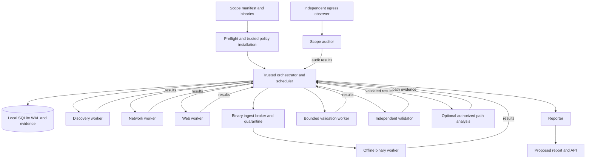

# MITIGATA — Autonomous Multi-Agent Penetration Testing Engine

**Research and solution design** · 31 October 2026 · Status: the hunt pipeline (discovery, web, network, binary, verification, attack path, report and dashboard) is implemented and tested; see the README for what is and is not built. This document remains the design of record and is not a claim of hidden-lab performance.

---

## 0. TL;DR

**Recommendation:** build a **deterministic breadth-first engine** wrapped by a team of specialised agents on a shared blackboard, with an **independent validator** that reproduces every finding before it is reported. Use LLMs only for bounded reasoning (custom PoC generation, unusual-service interpretation, remediation prose), never for scope decisions or verification verdicts.

**Why not just use an existing agent framework?**

- Existing autonomous pentest engines are **web/app-centric**, not network-range + binary + PTES engines. Strix, PentAGI, RedAmon and PentestGPT are strong at web/app testing; none ships a CIDR-scoped network sweep, native-binary analysis, a PTES phase model, and a confirmed-only evidence pipeline together.
- Fully autonomous LLM agents are still unreliable. AutoPenBench measured **21% success for a fully autonomous agent vs 64% for a human-assisted one** on its 33 tasks ([paper](https://aclanthology.org/2025.emnlp-industry.114/)); those results are not a forecast for this lab. The PRD targets no human input, so any such design needs independently tested controls and oracles, not just a bigger prompt.
- CAI, often cited as the reference framework, is **archived** (August 2026) and its Alias Robotics code is no longer plain open source ([repo](https://github.com/aliasrobotics/CAI)). It is not a foundation to build on.

**Stack:** Python 3.12 + FastAPI + SQLite (WAL) + asyncio; `naabu`/`nmap` for network; `httpx`/`katana`/ZAP/`nuclei`/Playwright for web; `r2pipe` + `r2ghidra` (xref-scoped) + `cwe_checker` + FLOSS + `angr`, with Ghidra headless as fallback, for binaries; Docker Compose for one-command deployment.

**Design goals (not implemented guarantees):**

1. **Fail-closed target scope:** compile authorized IP ranges minus exclusions; enforce egress in a trusted layer outside untrusted tool-worker control, then add application/browser checks and independent egress observation. Target: **zero out-of-scope target packets**, verified by tests.
2. **Confirmed-only main report:** require reproducible evidence, an independent validation run, and class-appropriate counterfactual/controls; keep inconclusive leads in a separate appendix.
3. **Scheduled-check completion:** report whether scheduled asset × attack-class checks finished, and disclose untested gaps. Only planted ground truth can measure actual host/weakness recall.
4. **One command, no prompts (future):** a planned CLI/container entry point, contingent on safety and feasibility tests, with explicit failure when required authorization or isolation is unavailable.

**What I could not access and need from you** is in [§14](#14-information-gaps-and-what-i-need-from-you): the hidden lab's scope/binaries/flags, the judge environment, the LLM policy, and the scoring harness details.

---

## 1. Decoding the PRD

### 1.1 The scoring function drives the architecture

The PRD is not asking for "an AI that hacks". It is asking for a **coverage-and-precision machine under a hard deadline**. The metrics imply specific engineering choices:

| Metric | Good | Great | Engineering implication |
|---|---|---|---|
| Host/service coverage | >70% | >90% | Budgeted discovery and service inventory; a full-port sweep only where range size, global rate limit and deadline permit. Discovery probes can miss live hosts. |
| Planted weaknesses found | >60% | >85% | High-yield check packs; broad web crawl; common injection classes; binary strings/static analysis; prioritise planted-style weaknesses. |
| Verified | half | all | Class-appropriate oracle and controls, independent validator, confirmed-only main report. |
| False alarms | <30% | <10% | Reject candidates that cannot be reproduced; do not report informational noise; two-oracle quorum for high/critical. |
| Scope safety | ≤1 stray | none | Trusted egress enforcement, app guard, independent packet observation and isolated out-of-scope canary tests. |
| Runtime | <1 h | <20 min | Two-stage scan; parallel workers; curated templates; deadline-aware scheduler; tiered depth. |
| Autonomy | one command | no input at all | No prompts; defaults for every decision; fail fast on missing scope, not on missing answers. |

The dominant risk is **not** missing a clever exploit. It is **spending the 20 minutes on the wrong things** and **reporting unverified guesses**. The design therefore optimises for breadth first, then depth on high-yield candidates, then verification.

### 1.2 Hard constraints

- **No destruction.** Read-only post-exploitation, no DoS, no persistence, no data exfiltration, no ransomware-like behaviour.
- **No out-of-scope traffic.** A single stray probe can fail the run; the design treats egress as a security boundary.
- **No 0-days.** The lab contains planted weaknesses; deep fuzzing/research is out of scope.
- **No human input.** The engine must decide, degrade, and finish. An LLM API key is configuration, not a human step.

### 1.3 PTES: seven phases, not five

PTES defines **seven** sections: Pre-engagement Interactions, Intelligence Gathering, Threat Modeling, Vulnerability Analysis, Exploitation, Post-Exploitation, Reporting ([PTES standard](https://pentest-standard.readthedocs.io/en/latest/)). The PRD's example "port scan → Intelligence Gathering" is correct under PTES; scanning is part of intelligence gathering, not a separate phase.

| PTES phase | What the engine does | Example artefacts |
|---|---|---|
| Pre-engagement | Parse written scope and RoE; validate exclusions, enforcement, limits and route before work starts. | Proposed scope manifest and preflight record |
| Intelligence Gathering | Host discovery, port scan, service fingerprint, OSINT, web crawl, binary inventory. | `asset.discovered`, `service.identified`, `endpoint.discovered` |
| Threat Modeling | Build the asset/service graph; rank paths to crown jewel; choose checks. | `attack_path.updated`, priority queue |
| Vulnerability Analysis | Nuclei/ZAP/custom web checks; service checks; static binary analysis. | `candidate.created` |
| Exploitation | Default-credential attempts, PoC execution, auth bypass, file read, command execution in sandbox. | `validation.passed`, `access.gained` |
| Post-Exploitation | Only if explicitly allowed by RoE: bounded access confirmation; Deep-tier/bonus path evidence when safely reachable. | Proposed authorized path/flag evidence |
| Reporting | Assemble report, attack path, coverage matrix, evidence, remediation. | `report.md/html/json` |

Every task, candidate, evidence item and report section carries a `ptes_phase` field. This is not a label added at the end; it is part of the work item schema, so the report can be generated by grouping.

---

## 2. State of the art

### 2.1 Autonomous pentest engines

| Engine | License | Multi-agent | Network range | Web | Native binary | PTES | Verification | Autonomy | Verdict for this PRD |
|---|---|---|---|---|---|---|---|---|---|
| **Strix** | Apache-2.0 | Yes, "graph of agents" | Individual IPs and target lists; no purpose-built CIDR coverage | Strong: Caido proxy, browser, Python exploit runtime | SAST/code, not native RE | No | PoC validation | `strix -n` headless | Best web sub-agent; not a full engine. |
| **PentestGPT** | MIT | Staged pipeline / 3 modules | Target-based | Yes | CTF rev/pwn | No | Mostly manual/CTF | `pentestgpt --mode pentest` | Useful task-tree idea; not multi-surface. |
| **PentAGI** | MIT | Yes, specialist delegation | Target-based | Strong, 20+ tools | No native RE | No | LLM-driven | Full, Docker sandbox | Quick-start minimum: 2 vCPU, 4 GB RAM, 25 GB disk; Neo4j/Graphiti are optional. |
| **RedAmon** | MIT | Yes, "fireteam" + Neo4j graph | Domain/IP recon | Strong; XBOW 101/104 self-reported | No | No | AI validation | Human approval gates | 8 GB RAM; disk minimum differs by official deployment profile (80 GB guide; 100 GB repo README). |
| **CAI** | MIT + proprietary/research-only | Yes | Target-based | Yes | Limited | No | LLM-driven | Yes | **Archived Aug 2026**; do not build on it. |
| **Nebula** | BSD-2 (per Ostorlab) | Assistant | No | Yes | No | No | Human | No | Not autonomous. |
| **HexStrike AI** | MIT | MCP tool server | No | Tool suite | Tools | No | External LLM | Needs client | Tool layer, not an engine. |

Sources: Strix [repo](https://github.com/usestrix/strix) and [CLI docs](https://docs.strix.ai/usage/cli); PentestGPT [repo](https://github.com/GreyDGL/PentestGPT) and [USENIX Security 2024 paper](https://www.usenix.org/conference/usenixsecurity24/presentation/deng); PentAGI [quick start](https://pentagi.com/docs/getting-started/quickstart/) and [repo](https://github.com/vxcontrol/pentagi); RedAmon [deployment guide](https://www.redamon.org/docs/deploying-to-a-server), [repository deployment README](https://github.com/samugit83/redamon/blob/master/tooling/deploy/single-host/README.md), and [repo](https://github.com/samugit83/redamon); CAI [repo](https://github.com/aliasrobotics/CAI); Nebula/HexStrike and the hands-on comparison: [Ostorlab, 9 Open-Source AI Pentesting Tools Compared (2026)](https://blog.ostorlab.co/9-open-source-ai-pentest-tools-2026.html). The Ostorlab comparison is third-party and Ostorlab sells a competing product; treat it as directional, not independent.

**What this means:** none of the surveyed tools is a verified drop-in solution to this specific PRD. Strix accepts IP targets but does not provide a purpose-built CIDR coverage and native-binary workflow. A small, independently evaluated core may be easier to audit than adapting a full platform; neither route guarantees scope, verification or runtime without testing.

### 2.2 Surface tools

| Layer | Tool | License | Role | Caveat |
|---|---|---|---|---|
| Host/port discovery | **naabu** | MIT | Fast SYN/CONNECT full-port sweep; JSON; `-verify` | Raw SYN needs `NET_RAW`; full scan needs rate control. |
| Service/OS + NSE | **nmap** | NPSL (GPLv2-based) | `-sV`, explicitly reviewed NSE scripts, XML output | The `safe` category is broad; NSE scripts are not sandboxed. Review each script and time bound. |
| Fast internet-scale scan (optional) | masscan | AGPL-3.0 | Extremely fast SYN | AGPL obligations; raw sockets; avoid in distributed image unless compliant. |
| HTTP probing | **httpx** | MIT | Status, title, tech, TLS, headers; JSONL | Not a scanner; use for inventory. |
| Crawling | **katana** | MIT | Standard/headless, JS parsing, forms, XHR, scope flags | Headless mode is slower; cap depth/pages. |
| Passive/active web | **ZAP** | Apache-2.0 | Baseline passive scan, spider, API scan, active rules | Full active scan is slow/noisy; use targeted policy. |
| Template scanning | **nuclei** | MIT | CVEs, exposures, misconfigs, default logins, DAST | Disable destructive tags, `-code`, external `-interactsh`. |
| Content/param fuzzing | ffuf | MIT | Directory/parameter discovery | Rate-limit; scope; avoid destructive payloads. |
| SQLi (optional) | sqlmap | GPL-2.0 | Confirm SQLi with boolean/error techniques | Noisy; restrict risk/level; no data dump. |
| SMB/Windows | NetExec / Impacket | BSD-2 / Apache-1.1-like | SMB, WinRM, credential reuse | Authorised lab only; no credential dumping. |
| Decompiler (default) | **r2ghidra via r2pipe** | r2ghidra LGPL-3.0; r2pipe MIT | Persistent r2 session; xref-scoped `pdg` only on candidate functions; no JVM per binary | Plugin must be pinned; output quality varies on stripped/optimized code; fall back to `pdf` and Ghidra |
| Decompiler (fallback/batch) | **Ghidra** | Apache-2.0 | Headless import/analyze for full call graph, PE artifacts, or functions r2ghidra fails on | JVM startup; at most one project per run; shares the binary analysis sub-budget |
| Binary CWE analysis | **cwe_checker** | LGPL-3.0 | Static checks (primarily ELF binaries) | ELF only; static false positives/negatives; verify applicability and reachability. |
| Binary strings | **FLOSS** | Apache-2.0 | Static/stack/decoded strings; hardcoded secrets | Not a vulnerability prover; candidate generator. |
| Symbolic execution | **angr** | BSD-2-Clause | Find stdin/argv reaching a target address or an unconstrained instruction pointer; structured wrapper with caps | State explosion; timeout is `inconclusive`, not proof of absence. |
| RE CLI / scripted decompilation | radare2 + r2pipe | LGPL-3.0 / MIT | Fast triage, disassembly, xrefs, per-function `pdg` | Verify radare2 license before redistribution. |
| PE mitigations | winchecksec | Apache-2.0 | ASLR/DEP/CFG/GS/signing for PE artifacts | ELF `checksec`/`readelf`/`nm` do not apply to PE. |
| Browser proof | **Playwright** | Apache-2.0 | DOM XSS execution, screenshots, request routing | Must block out-of-scope requests at the route layer. |
| Orchestration | **LangGraph** | MIT | Durable graph/checkpointing for bounded agent loops | Optional; do not let it own scope/state of record. |
| Agent framework (not recommended as core) | CrewAI | MIT | Role-based crews | Role-play tends to duplicate work; weak deterministic control. |
| API/state | FastAPI, SQLite, Pydantic, NetworkX | MIT/public domain/BSD-3 | API, blackboard, schemas, attack graph | SQLite is enough for a single-node lab run. |

Licenses verified from each project's repository metadata/README on 2026-10-31. Nmap's NPSL is GPLv2 plus additional terms; sqlmap is GPL-2.0; Impacket uses a modified Apache-1.1 license; masscan is AGPL-3.0. Include `THIRD_PARTY_NOTICES.md` and source offers where required.

### 2.3 Orchestration frameworks

- **LangGraph** is a low-level orchestration framework with durable execution, human-in-the-loop interrupts, memory and subgraphs ([README](https://github.com/langchain-ai/langgraph)). It is a good fit for a **bounded per-asset investigation loop** (plan → act → observe → decide) with checkpointing.
- **CrewAI** is a role-based multi-agent framework ([README](https://github.com/crewAIInc/crewAI)). It is fast to prototype, but its free-form role-play and conversational handoffs are the opposite of what this PRD needs: deterministic dedup, deadlines, and scope enforcement.
- **Custom asyncio + SQLite** gives first-class control over task claiming, leases, dedup keys, deadline scheduling and audit. For a single-node lab run, it is simpler and more reliable than a distributed agent platform.

**Decision:** custom deterministic orchestrator as the source of truth; optional LangGraph subgraphs for LLM-assisted investigation; no CrewAI in the core.

### 2.4 Benchmarks and what they imply

- **AutoPenBench** (33 tasks): fully autonomous agent **21% success**, human-assisted **64%**; the fully autonomous agent solved only one real-world task ([paper](https://aclanthology.org/2025.emnlp-industry.114/)). These benchmark outcomes do not predict performance on the hidden lab; do not use them as a coverage estimate.
- **Cybench** (40 professional CTF tasks) is a capability benchmark, not a coverage benchmark ([site](https://cybench.github.io/), [arXiv:2408.08926](https://arxiv.org/abs/2408.08926)). High CTF scores do not imply reliable multi-host coverage.
- **XBOW-style web benchmarks** are self-reported by vendors: RedAmon claims 101/104 (97.1%) fully black-box ([README](https://github.com/samugit83/redamon)); PentestGPT reports a historical 86.5% (90/104) and explicitly says it is not a current regression guarantee ([README](https://github.com/GreyDGL/PentestGPT)). These are useful signals for web depth, not proof of end-to-end lab performance.

### 2.5 Gap analysis

None of the surveyed engines provides all of:

1. CIDR-scoped network discovery with hard egress enforcement.
2. Native-binary static + dynamic analysis.
3. PTES phase tagging on every step.
4. Confirmed-only findings with independent reproduction and class-appropriate controls.
5. A coverage matrix with a completion gate.
6. One-command, no-human operation with an aspirational sub-20-minute target that must be validated per tier and scope size.

That gap is the project. The novel part is not a new LLM prompt; it is the **coordination + verification + scope** layer around proven tools.

**Why not fork one of them?**

- **Strix:** supports individual IPs and target lists, but not the required CIDR-coverage and binary workflow as an integrated feature. Suitability as a component remains to be evaluated behind independently enforced scope controls.
- **PentAGI:** a full platform with a documented 2 vCPU / 4 GB RAM / 25 GB disk quick-start minimum; Neo4j and Graphiti are optional. Adapting it for this exact lab and deadline would require separate feasibility testing.
- **RedAmon:** strong graph/recon design with a web/bug-bounty focus; documented 8 GB RAM minimum and disk requirements of 80 GB or 100 GB depending on the official deployment profile. Check its actual approval/default behavior and runtime before comparing against the no-human target.
- **PentestGPT:** a CTF-oriented staged pipeline with a single target; useful ideas (task tree, staged context) but not a multi-surface engine.
- **CAI:** archived and license-restricted; not a foundation.

Forking also inherits upstream churn, hidden prompts, and tool defaults that may send out-of-scope traffic. A small, owned core is easier to audit and tune to the lab.

---

## 3. Proposed solution

### 3.1 Design principles

1. **Deterministic core, LLM at the edges.** The scheduler, scope guard, tool wrappers, dedup, coverage and validator are code. The LLM proposes; the engine disposes.
2. **Evidence-first, confirmed-only.** A finding needs a claim, reproducible artefact and an appropriate control/counterfactual (or independent corroboration when no safe control exists). No validated artefact, no finding.
3. **Scope should be a network invariant.** Install target egress restrictions outside untrusted worker control; also validate at the application layer and audit independently. Never rely on a prompt or a tool's `--scope` flag alone.
4. **Blackboard, not chat.** Agents communicate through typed events and database rows, not free-form conversation. This makes handoffs auditable and idempotent.
5. **Deadline-aware breadth-first.** Cover all assets cheaply, then deepen on high-yield candidates. Stop low-yield work when the clock is short.
6. **Config over code.** Checks and agents are YAML; adding a check should not require editing the orchestrator (bonus B-4).

### 3.2 Architecture



**Deployment topology (Docker Compose):**

- `orchestrator` — trusted Python engine, API, scheduler, reporter and **sole writer** of the local evidence store and SQLite WAL database. No target route; optional external LLM access only when explicitly permitted and redacted.
- `scanner` — target-scoped discovery tools; an egress policy installed and protected by a trusted host/initializer, not by the scanner. A narrow authenticated internal channel carries jobs/results to the orchestrator; no other internet route. Drop `NET_ADMIN` irrevocably before worker code/tool execution (or enforce at the host outside its namespace); `NET_RAW`, if used, does not confer policy-editing rights.
- `web` — target-scoped browser and web tooling with the same independently controlled egress policy and narrow control channel; browser route checks are secondary safeguards.
- `binary` — offline, read-only analysis sandbox with no target-network route; artifacts enter only through the orchestrator's ingest broker and results return only over the constrained control channel.
- `dashboard` — optional read-only API view. SQLite is a **file on the orchestrator's local filesystem**, not a separate `db` service or a multi-host shared writable volume. SQLite WAL does not work over a network filesystem ([SQLite WAL](https://www.sqlite.org/wal.html)).

The policy must distinguish the explicitly authorized **target address set** from narrow infrastructure/control-plane traffic (worker → orchestrator only, plus a permitted in-scope DNS resolver). Control-plane IPs are not target scan authorization. Untrusted workers must not be able to modify policy, mount or write the DB/evidence directory, or use the control channel as a general network proxy. Validate those assumptions with independent egress observation; a container topology by itself does not prove them.

**Constrained environments:** a single container with self-managed in-namespace nftables and retained `NET_ADMIN` is a development convenience, **not** an acceptable scope-safety guarantee. Refuse an assessment run if trusted enforcement and observation cannot be established; do not silently switch to a less isolated profile.

### 3.3 Agent roles and contracts

Each proposed agent is a worker with a role, tools, input events, output events, a budget and stop conditions. Budgets below are illustrative, not measured against the hidden lab. The trusted scheduler claims tasks; workers submit observations and do not write the database directly.

| Agent | Responsibility | Tools | Input events | Output events | Budget |
|---|---|---|---|---|---|
| **Preflight/Scope** | Parse and validate scope; compile allowlist; pin DNS; check route; hash binaries. Deterministic. | Python, nft, dnspython | `run.started` | `scope.compiled` | 30 s |
| **Discovery** | Budgeted host/port discovery and service inventory; log uncertainty for nonresponding hosts. | naabu, nmap | `scope.compiled`, `endpoint.discovered` | `asset.discovered`, `port.open`, `service.identified` | Size-dependent, set in preflight |
| **Network** | Service-specific enumeration and checks: SMB, FTP, SSH, DBs, Redis, Docker/K8s, SNMP. | nmap NSE, NetExec, Impacket, smbclient, redis-cli, psql/mysql | `service.identified` | `candidate.created`, `credential.found`, `binary.found` | 4 min |
| **Web** | Crawl, endpoint/param inventory, passive and targeted active checks. | httpx, katana, ZAP, nuclei, ffuf, Playwright | `service.identified` (HTTP), `endpoint.discovered` | `endpoint.discovered`, `candidate.created`, `candidate.needs_poc`, `binary.found` | 8 min |
| **Binary** | Artifact ingest validation; static triage; xref-scoped decompilation; secret extraction; symbolic reachability; offline replay. | r2pipe/r2ghidra, Ghidra (fallback), cwe_checker, FLOSS, angr, pwntools | `binary.ingested` | `candidate.created`, `credential.found`, `endpoint.discovered`, `binary.analyzed` | 6 min (parallel; ≤4 artifacts) |
| **Exploit/PoC** | For candidates without a ready oracle, write a bounded PoC; run it in the sandbox; capture evidence. LLM-assisted. | Python sandbox, Playwright, pwntools | `candidate.needs_poc` | `candidate.ready_for_validation` | 60 s/finding, max 10 |
| **Validator** | Independent, bounded reproduction with a fresh permitted test context and class-appropriate control; confirm/reject/inconclusive. | Python oracles, Playwright, sandbox | `candidate.ready_for_validation` | `validation.passed`, `validation.failed` | 30-60 s/finding (illustrative) |
| **Chainer (bonus, Deep tier)** | Link independently confirmed, authorized evidence; do not probe inaccessible networks without an approved scope-enforced route. | NetworkX; RoE-approved access checks | `validation.passed` | `attack_path.updated` | Only if budget and RoE permit |
| **Reporter** | Assemble report; LLM writes remediation prose; deterministic template. | Jinja2, Markdown, Mermaid, WeasyPrint | `run.finalizing` | `report.ready` | 60 s |
| **Scope Auditor** | Compare worker events with independent host/veth egress observations; fail closed on policy failures and report blocked attempts separately from sent strays. | Trusted observer and event log | continuous | `scope.violation`, `scope.audit` | continuous |

**Event schema:** `{id, run_id, ts, agent, type, payload, ptes_phase, dedup_key}`. Every event is persisted, so the dashboard and the report can replay the run.

**What makes these agents, not a pipeline:** each agent has a goal, a tool allowlist, a budget, and local decision authority (which endpoints to test, which payload family to try, when to hand off, when to stop). The scheduler arbitrates priorities and deadlines; it does not micromanage every step. LLM-assisted agents can propose new work items within their surface; deterministic agents can reject unsafe or out-of-scope proposals. Handoffs are explicit events, and findings are shared through the blackboard, so the team exhibits the two properties the PRD actually tests: specialisation and non-duplication.

**Agent contract (YAML):**

```yaml
id: web-agent
role: web
model: ${LLM_MODEL:-deterministic}
tools: [httpx, katana, zap, nuclei, ffuf, playwright]
subscribes: [service.identified, endpoint.discovered]
publishes: [endpoint.discovered, candidate.created, candidate.needs_poc, binary.found]
budget:
  max_steps: 60
  max_seconds: 480
  max_llm_calls: 12
stop_conditions:
  - deadline_reached
  - no_pending_web_tasks
  - scope_violation
```

### 3.4 Coordination and dedup

**Proposed blackboard tables (orchestrator-owned SQLite WAL on a local filesystem):**

- `runs`, `assets`, `services`, `endpoints`, `binaries`
- `candidates`, `evidence`, `validations`
- `tasks`, `work_registry`, `coverage`, `events`, `scope_events`, `credentials`, `flags`, `attack_paths`

Workers submit bounded results through the internal channel; they do not have a writable mount of the DB or authoritative evidence. SQLite is a local file, not a networked service.

**Task claiming (proposal):** the orchestrator serializes claims and writes results using transactions and unique work keys. Expired leases can be retried, so at-least-once execution and occasional duplicate attempts are possible, especially after crashes. Record attempt IDs; make result insertion idempotent and audit retries rather than claiming exactly-once execution.

**Dedup keys:**

- Discovery: `sha256(run, "port", ip, port, proto)`
- Web endpoint: `sha256(run, "endpoint", service_id, method, normalized_url)`
- Check: `sha256(run, "check", asset_id, service_id, check_id, normalized_param)`
- Candidate/root cause: `sha256(run, "candidate", asset_id, service_id, endpoint_id, vuln_class, parameter)`; evidence hashes belong on **individual evidence/attempt records**, not the candidate key, so repeated observations can consolidate.
- Binary artifact: `sha256(run, "binary", sha256)`
- Decompiled function: `sha256(run, "decomp", binary_sha256, function_addr)`
- Reachability query: `sha256(run, "reach", binary_sha256, target_addr, target_kind)`
- Credential reuse: `sha256(run, "reuse", credential_id, service_id)`

**Binary artifact ingest (inbound).** The `binary` container has no target route; artifacts enter only through the orchestrator's broker.

1. `Web` or `Network` discovers a downloadable artifact and emits `binary.found` with `{source_kind: http|smb|ftp|kickoff, source_ref, sha256?, size?}`. The discovering worker performs the fetch under its own scope guard; `kickoff` artifacts are read from the run input directory.
2. The `binary_ingest` broker caps the stream at 64 MiB, verifies magic (`\x7fELF` or `MZ`) and sha256, rejects archives and scripts, stores it read-only at `evidence/binaries/<sha256>/artifact`, exposes only that file to the binary container on a read-only mount, and emits `binary.ingested`.
3. Duplicate sha256 is not stored twice; the broker re-emits `binary.ingested` for the existing row.
4. Invalid, oversized or unsupported artifacts emit `binary.rejected` with `{reason}` and schedule no analysis.
5. Admission: at most 4 artifacts per run; the scheduler admits an artifact only while the Binary worker has ≥35 s of its 360 s budget remaining. Later artifacts emit `binary.deferred` with `{reason: "binary_budget"}`.

**Credential and endpoint fan-out (outbound).**

- `Binary` emits `credential.found` with `{kind: password|token|private_key, secret_ref, source: "binary:<sha256>:<offset>", confidence: "static"}`. Plaintext never appears in the event, log or LLM prompt.
- The orchestrator writes `credentials` and creates reuse tasks: `Network` for ssh/smb/ftp/db/redis kinds, `Web` for http/form/basic kinds. Reuse tasks are ordinary checks tagged `exploitation` or `post_exploitation`, subject to 3 attempts per credential per service and deduped by `sha256(run, "reuse", credential_id, service_id)`.
- `Binary` emits `endpoint.discovered` for hardcoded URLs, hosts and ports. The orchestrator fans URLs to `Web` and host/port literals to `Discovery` after scope compilation; out-of-scope literals are stored as `out_of_scope_literal` and never probed.
- Consumers read secrets through the orchestrator at use time; events, logs and reports carry `secret_ref` and redacted context.

**Handoff examples:**

1. Discovery finds `10.10.5.10:8080` with an HTTP banner → emits `service.identified` with `kind=http`. Web agent claims it, probes `http://` and `https://`, crawls, emits endpoints. Network agent does not re-scan the port.
2. A web worker emits a candidate with a proposed **in-scope, RoE-permitted** oracle; the independent validator records the claim, control evidence and verdict through the trusted orchestrator.
3. A binary worker emits a static-analysis lead; it remains inconclusive unless independent, authorized testing demonstrates an actual effect.
4. The optional path analysis links **existing confirmed evidence** only; testing additional access requires separate RoE authorization and a scope-enforced route.
5. Web finds `/download/backup.bin` → `binary.found`; the broker ingests it and emits `binary.ingested`; Binary extracts a PostgreSQL password → `credential.found`; the orchestrator schedules a Network reuse check; the independent validator confirms login and captures the marker.
6. Binary extracts `http://10.10.5.30:9000/api` → `endpoint.discovered`; the orchestrator scope-checks it, Web probes it, and Discovery records the port. A literal outside the compiled scope is stored as `out_of_scope_literal`, not probed.

**Reduce repeated work (goal):** the orchestrator registers each normalized work item before dispatch; unique keys deduplicate scheduled checks and observations, but retries and distinct aliases can still produce duplicate work. Report attempted vs completed tasks and handoffs; test root-cause consolidation against fixtures rather than assuming no duplicate scans.

### 3.5 Scheduler and time budget

**Priority:**

```
priority = (estimated_yield × permitted_exposure) / (estimated_seconds + 1)
```

- Yield and exposure estimates must come from local lab measurements, not fixed untested class scores.
- Tier changes the **eligible work and available budget**, not a multiplier shared by all tasks in the same run (a constant multiplier cannot reorder them).
- Reserve time for verification and reporting; prioritize an honest partial report over silently skipping gaps. Authentication checks need explicit RoE permission and global, cross-worker attempt limits.

**Illustrative wall-clock allocation for a small scope (20-minute Great target, not a Deep-tier guarantee):**

| Window | Work |
|---|---|
| 0:00-0:00:30 | Preflight, scope compile, route check, binary hash |
| 0:00:30-0:01:30 | Initial discovery; log nonresponders as unknown, not absent |
| 0:01:30-0:06:00 | Budgeted service discovery; expand only if global rate and deadline permit |
| 0:02:00-0:10:00 | Web crawl + passive checks (overlaps scanning, per host as soon as HTTP is known) |
| 0:03:00-0:12:00 | Nuclei/custom checks + binary static analysis (parallel) |
| 0:08:00-0:15:00 | Validation of candidates (interleaved, not batched at the end) |
| 0:12:00-0:17:00 | Optional RoE-approved Deep-tier/bonus path analysis, if a scope-enforced route exists |
| 0:17:00-0:19:30 | Report render, coverage gate, API publish |

Tier scaling is a **policy choice**, not a promise: each tier needs a documented range size, permitted protocols, global per-run rate and deadline. Discovery may miss hosts that ignore initial probes; do not treat a silent host as tested absent. A two-stage service inventory can limit expensive fingerprinting to observed open ports, but full-range coverage is conditional.

**Feasibility check:** even ignoring retries, service detection, web checks, binary analysis and reporting, `50 × 65,535 / 5,000 ≈ 11 minutes` for 50 scoped addresses, whereas `256 × 65,535 / 5,000 ≈ 56 minutes` for a whole `/24`. A global 5,000-packets/s cap across workers cannot deliver a complete `/24` full-port sweep in 20 minutes. Preflight should decide which checks fit the budget, record exactly what was tested, and mark the rest untested. Separate image build/setup time from assessment-runtime measurement.

### 3.6 LLM guardrails and degradation

The LLM is a **proposal engine**, not an authority. The following rules are enforced in code:

- **Structured output only.** Every LLM response is validated against a Pydantic schema (tool name, argv list, target, rationale, expected oracle). Free-form shell is rejected.
- **Tool allowlist.** The model may select only registered tools and check IDs; arguments are parsed and scope-checked by `ScopeGuard`. No `shell=True`, no string interpolation into a shell.
- **Untrusted target content.** Banners, HTML, JS, error pages and file contents are delimited as data. Instructions found in target content are never treated as system/user instructions. A prompt-injection attempt can at worst waste a call or produce a candidate that fails validation.
- **No secrets in prompts.** Credentials, cookies, flags and raw request bodies are redacted; the model sees a minimal, structured summary. Target data is never sent to an external API if the engagement forbids it; a local model can be selected.
- **Network separation (to be tested).** The orchestrator has no target route; any external LLM access requires explicit RoE permission and redaction. Worker egress, including the narrow control channel, must be independently constrained; do not assume a prompt-injected model or compromised tool cannot bypass policy until tested.
- **Budgets.** Per-agent step/time/token caps, per-finding PoC cap, and a global deadline. Cached results are reused; repeated identical prompts are deduped.
- **Degradation.** If the LLM is unavailable or over budget, deterministic checks, validation and reporting still complete. The report records `llm_degraded: true` and lists which checks were skipped. This preserves one-command autonomy and avoids a hard dependency on a cloud service.
- **Audit.** Prompts/responses are logged with secrets redacted, so a reviewer can reconstruct why a candidate was proposed. The validator's verdict is independent of that log.

---

## 4. Surface playbooks

### 4.1 Network

**Discovery:**

```bash
# Host discovery: ARP on L2, ICMP/TCP elsewhere
nmap -sn -PR -PE -PS22,80,443 -PA80,443 --reason -oX discovery.xml "$CIDR"

# Full TCP sweep (SYN if root/NET_RAW, CONNECT otherwise), JSON
naabu -list hosts.txt -p - -rate 5000 -c 50 -verify -json -o ports.jsonl

# Service/version inventory on observed open ports; add only reviewed NSE scripts
nmap -sV --version-intensity 5 -p "$PORTS" -oX services.xml "$HOST"

# Optional UDP top-50 on high-value hosts
nmap -sU --top-ports 50 --max-retries 1 --host-timeout 60s -oX udp.xml "$HOST"
```

Do not assume Nmap's `--script safe` is a narrow or deterministic policy: it is a broad category, and NSE scripts are not sandboxed ([NSE documentation](https://nmap.org/book/nse-usage.html)). Review and explicitly allowlist any script for scope, time and network side effects. Avoid external API/update calls unless separately authorized; do not rely on tool tags alone for scope enforcement.

**Checks (high-yield first):**

| Service | Check | Verification |
|---|---|---|
| FTP (21) | Anonymous login | `ftp` login succeeds; list a directory; negative control with a wrong user. |
| SSH (22) | Default/weak credentials; banner/version | Login succeeds and `id` runs; wrong password fails. Cap 5 attempts/account. |
| Telnet (23) | Default credentials | Login prompt + command output. |
| SMTP (25) | Open relay (non-destructive) | `RCPT TO` accepted for an external domain; use an in-scope test domain, not real spam. |
| DNS (53) | Zone transfer | `dig AXFR` returns records; negative control against a non-authoritative server. |
| SMB (139/445) | Null session, SMBv1, signing, shares | `smbclient -N -L` lists shares; read a marker file; negative control with bad creds. |
| NFS (2049) | Exported shares, `no_root_squash` | `showmount -e`; mount read-only; read marker. |
| LDAP (389/636) | Anonymous bind | `ldapsearch -x -b "" -s base` returns naming contexts. |
| MySQL/Postgres (3306/5432) | Default creds; unauth | `SELECT version()`; wrong password fails. |
| Redis (6379) | Unauthenticated access | `PING` → `PONG`; `INFO`; no writes. |
| MongoDB (27017) | Unauthenticated access | `listDatabases`; no writes. |
| Elasticsearch (9200) | Unauthenticated access | `GET /` returns cluster info; no index deletion. |
| Docker API (2375/2376) | Unauthenticated API | `GET /version`; do not create containers. |
| Kubernetes (6443/10250) | Anonymous auth / kubelet | `GET /version`; read-only. |
| SNMP (161/udp) | Default community `public` | `snmpwalk -v2c -c public`; read-only OIDs. |
| VNC (5900) | No authentication | RFB handshake; do not interact with the desktop. |
| RDP (3389) | NLA/version check | Banner/negotiation; no brute force. |
| Jenkins/Tomcat/Webmin | Default creds; exposed manager | Login success + protected page; negative control. |

**Verification for network findings:** a successful protocol handshake is not enough. Require an **impact action**: list a share and read a marker, run `id` over SSH, `SELECT version()` on a DB, `PING`/`INFO` on Redis. Store the exact command, stdout/stderr, exit code and a screenshot where relevant.

### 4.2 Web

**Inventory:**

```bash
httpx -l hosts.txt -ports 80,443,8000,8080,8443,3000,5000,9000 -title -tech-detect -status-code -web-server -json -o http.jsonl

katana -list urls.txt -d 3 -jc -jsl -hl -fx -xhr -jsonl -o crawl.jsonl \
  -rl 50 -cs '^https?://10\.10\.5\.'
```

Use headless only for JS-heavy apps; cap pages per host (e.g., 500) and depth 3. Parse `robots.txt`, `sitemap.xml`, OpenAPI/Swagger, GraphQL introspection, source maps, and JS for endpoints.

Katana uses Go's RE2 regex engine, which **does not support negative lookahead**. Use `-cs` with an in-scope positive regex; do not write `-cos '... (?! ...)'`. The network allowlist and browser route guard are the authoritative boundary, not the crawler regex.

**Passive:**

```bash
zap-baseline.py -t "$URL" -J zap.json -r zap.html -m 1
```

Passive checks: missing security headers, cookie flags, TLS, CORS, CSP, clickjacking, directory listing, debug pages, stack traces, source maps, `.git/config`, `.env`, backups, default files, information disclosure.

**Active (targeted, non-destructive):**

- **Nuclei:** use an independently reviewed, pinned and RoE-permitted template set. `-jsonl-export` requires an output filename; `-duc` disables automatic update checks ([Nuclei README](https://github.com/projectdiscovery/nuclei/blob/main/README.md)). Template tags alone do not ensure non-destructive behavior. Exclude code templates and external interaction unless explicitly authorized.
- **Custom checks:** SQLi (error/boolean/time), XSS (reflected/stored/DOM), command injection, LFI/path traversal, SSRF, XXE, SSTI, upload, IDOR/BOLA, auth bypass, JWT weaknesses, mass assignment, open redirect, business logic.
- **ZAP:** passive baseline by default; active scan only on high-value endpoints with a custom policy that excludes destructive rules and caps time.
- **ffuf:** small wordlist (common directories, backups, admin panels), auto-calibration, rate limit.

**High-yield paths:** `/admin`, `/login`, `/manager/html`, `/jenkins`, `/actuator/env`, `/swagger-ui.html`, `/api`, `/.git/config`, `/.env`, `/backup.zip`, `/phpmyadmin`, `/console`, `/debug`, `/graphql`, `/upload`.

**Verification:** see §5.3. Key rule: **reflection is not XSS**; require DOM execution. **A 200 on a nonexistent path is not a finding**; require a differential or a known file. **A version banner is not a CVE**; require a safe probe or a confirmed default credential.

### 4.3 Binary

All analysis is offline: the `binary` container has no target route. Artifacts enter only through the ingest broker (§3.4), are stored read-only under `evidence/binaries/<sha256>/`, and are not executed during triage or decompilation.

**Stage 0 — ingest (broker):** magic `\x7fELF` or `MZ`; size ≤64 MiB; sha256; reject archives/scripts; dedup by sha256. A validated artifact is stored read-only and announced as `binary.ingested` once per sha256. Unsupported format or size is `binary.rejected` with a reason and no analysis task.

**Stage 1 — triage (<5 s per artifact):**

```bash
file "$BIN"
checksec --file="$BIN"                     # ELF: PIE, NX, canary, RELRO
readelf -h -l -s "$BIN"                    # ELF only
nm -D "$BIN"                               # ELF only
strings -a -n 4 "$BIN" > strings.txt
floss -j "$BIN" > floss.json               # static/stack/decoded strings
cwe_checker --out json --quiet "$BIN" > cwe.json   # ELF only; skip PE with a logged reason
winchecksec "$BIN"                         # PE only
r2 -q -c 'aaa; afl; izz' "$BIN"            # one analysis pass; reused by Stage 2
```

`triage_binary(binary_path)` returns:

```json
{
  "format": "elf|pe", "arch": "x86_64", "bits": 64, "endianness": "little",
  "sha256": "…",
  "mitigations": {"pie": true, "nx": true, "canary": false, "relro": "partial"},
  "imports": [{"name": "gets", "addr": 4210720, "dangerous": true}],
  "strings": [{"value": "…", "offset": 8192, "encoding": "ascii", "secret_candidate": true}],
  "cwe_hits": [{"cwe": "CWE-120", "function_addr": 4198400, "description": "…"}],
  "errors": [{"stage": "cwe_checker", "reason": "unsupported format"}]
}
```

Dangerous imports: `gets`, `strcpy`, `strcat`, `sprintf`, `system`, `popen`, `execve`, `scanf`, and variable-length `memcpy`. Secret candidates: high-entropy tokens, `password|passwd|secret|token|api[_-]?key|BEGIN .*PRIVATE KEY`, URLs, internal hostnames, and flag patterns.

**Stage 2 — xref-scoped decompilation (≤30 s per artifact):**

- One persistent `r2pipe` session per artifact; reuse the `aaa` analysis from Stage 1.
- Candidate functions, in order: `main`; functions with xrefs to dangerous imports; functions with xrefs to secret-candidate string addresses; functions flagged by `cwe_checker`.
- Decompile only those with `s <addr>; pdg`; cap 25 functions and 8 KiB of pseudocode per function; dedup by function address.
- `pdg` failure or empty output: keep `pdf` disassembly, mark the function `source: "pdf"`, and queue it for the Ghidra fallback. Do not retry `pdg`.
- Ghidra headless runs at most once per run, only for queued fallback functions or when a full call graph is required:

```bash
analyzeHeadless /tmp/ghidra proj -import "$BIN" \
  -scriptPath /opt/ghidra-scripts -postScript ExportDecompiled.java /tmp/out \
  -analysisTimeoutPerFile 60 -deleteProject
```

- The 30 s cap covers `r2ghidra` work only. The Ghidra fallback is a separate 60 s job charged to the same 180 s analysis sub-budget as angr; Ghidra is attempted only when no angr query is pending.
- The default path does not send decompiled code to an LLM: candidate selection, secret detection, unsafe-function reachability, and the decision to call angr are deterministic (§3.6). The LLM remains a bounded proposal engine outside this path.

`get_decompiled_function(binary_path, function_addr)` returns:

```json
{"function_addr": 4198400, "name": "check_password", "pseudocode": "…", "disassembly": null,
 "source": "r2ghidra|ghidra|pdf", "elapsed_ms": 412, "error": null}
```

**Stage 3 — symbolic reachability (global 180 s):**

- `find_path_to_address(binary_path, target_addr=None, target_kind="addr", avoid_addrs=[], input_kind="stdin", timeout_s=60)` loads the artifact once with `auto_load_libs=False` and explores to `target_addr`, or to an unconstrained/out-of-object instruction pointer when `target_kind="unconstrained_ip"`, avoiding the listed addresses. `target_addr` is required for `target_kind="addr"` and ignored otherwise.
- Target priority: authenticated/success branch tied to a constant comparison; `system`/`popen`/`execve` call reachable from stdin/argv; unconstrained-IP crash.
- Budget: 60 s and 10,000 states per query; at most 3 queries per run; a query is admitted only while ≥65 s of the Binary worker budget remains.
- Returns:

```json
{"status": "found|timeout|unsat|error", "input_kind": "stdin|argv",
 "input_b64": "…", "target_addr": 4198400, "constraints": 12,
 "states": 431, "elapsed_ms": 18234, "error": null}
```

- `timeout` and `error` leave the candidate `inconclusive`; they do not assert absence of the weakness.
- angr's input is a candidate. The solver process never writes `validation.passed`.

**Stage 4 — offline dynamic replay (≤5 s per input):**

- `verify_binary_input(binary_path, input_b64, mode="stdin|argv")` runs in the `binary` container: no network, non-root, read-only rootfs, `cap_drop: ALL`, seccomp, 5 s wall, 256 MiB, 64 pids; stdin/argv only; capture exit code, signal, stdout/stderr (64 KiB cap).
- Returns `{exit_code, signal, stdout_b64, stderr_b64, timed_out, duration_ms}`.
- The Binary worker's replay is diagnostic. Confirmation requires the independent validator (§5.4) to replay from a fresh sandbox and compare with a control: a benign input, a wrong credential, or an input that avoids the target block.

**Checks:**

- Hardcoded password/secret/API key/flag: strings + FLOSS + xrefs; verify by using it against the binary/service through the validator.
- Authentication bypass: constant comparison (`strcmp`/`memcmp`) feeding a branch; angr target is the success block; verify the success observable.
- Unsafe function: xref + reachability; verify with a crafted crash or angr path.
- Format string: `printf(user_input)` pattern; verify with `%x`/`%s` crash/leak.
- Buffer overflow: `gets`/`strcpy` into a fixed stack buffer; verify with a controlled crash and stack trace.
- Command injection: `system`/`popen` with user input; verify with a sandbox `id`.
- Weak crypto: MD5/SHA1/DES/ECB/hardcoded key; static evidence + context.
- Mitigations: no PIE/NX/canary/RELRO; informational, not a standalone finding unless chained.

**PE artifacts:** `checksec`, `readelf`, `nm`, `objdump`, and `cwe_checker` are ELF-only. PE uses `file`, `winchecksec`, FLOSS, r2/r2ghidra, and Ghidra; `angr` loads PE through CLE. Missing capability is recorded in `errors`, not inferred.

**Verification:** static evidence alone is a candidate. Confirmed requires (a) a reachable target or observable effect, (b) replay by the independent validator in a fresh sandbox, and (c) a class-appropriate control. If dynamic replay is impossible or unsafe, report "static weakness (unverified)" in the appendix, not as a confirmed finding.

### 4.4 Optional path evidence (Deep tier / bonus B-2)

The baseline PRD requires an attack-path **report** built from confirmed, in-scope findings; reaching a protected crown jewel and capturing flags are bonus/tier-dependent work, not P0 for the baseline. Do not treat a hypothesized edge or an inferred host as proven access. Each confirmed edge needs a separate authorization check and independently retained evidence.

Any login, reversible state change or further access check needs explicit RoE permission, globally enforced attempt limits and a safe stop condition. Unreachable network segments remain **untested** unless organizers provide an explicitly authorized route with the same independently enforced scope controls; do not assume an unrestricted pivot. Store only permitted flag evidence and redact secrets from the public report.

---

## 5. Verification protocol

### 5.1 Finding lifecycle

```
candidate → validating → confirmed → exploited
                       ↘ rejected
                       ↘ inconclusive (appendix; not counted)
```

- **candidate:** a tool signature or LLM hypothesis. Not reportable.
- **confirmed:** an independent validator reproduced a bounded, authorized effect and an appropriate control/counterfactual (or independent corroboration) supports the conclusion.
- **exploited:** impact demonstrated within RoE without destructive testing; not required for every reported issue.
- **rejected:** the observed effect does not differ from an appropriate control, or the claim is disproven.
- **inconclusive:** cannot test safely or within budget; appendix only.

### 5.2 Evidence schema

```json
{
  "id": "E-0007",
  "candidate_id": "C-0012",
  "scope_hash": "<compiled-scope-sha256>",
  "type": "http_exchange",
  "ptes_phase": "exploitation",
  "request": {
    "method": "GET",
    "url": "http://10.10.5.10:8080/manager/html",
    "headers": {"Authorization": "Basic <redacted>"}
  },
  "response": {
    "status": 200,
    "headers": {"Content-Type": "text/html"},
    "body_sha256": "…",
    "body_path": "evidence/E-0007.body"
  },
  "control_evidence": [{
    "kind": "invalid_test_credential",
    "request": {"method": "GET", "url": "http://10.10.5.10:8080/manager/html", "headers": {"Authorization": "<redacted>"}},
    "response_status": 401
  }],
  "tool": "custom.http_basic",
  "timestamp": "2026-10-31T10:12:03Z",
  "sha256": "…"
}
```

Rules:

- Every reported finding needs a validated observation and a **class-appropriate control/counterfactual**. If no safe control exists, require separately corroborated evidence and state the limitation; do not substitute an out-of-scope probe.
- Store only necessary, RoE-permitted raw evidence; restrict file access and redact secrets/PII in reports and APIs. Authorized test credentials should be provided by secret reference, not embedded in manifests.
- Hashes detect accidental changes, but hashing evidence and its hash in the same writable location is **not** tamper-evidence. A trusted orchestrator owns the authoritative DB/evidence and anchors signed or otherwise protected manifests outside worker write access; even this does not protect against compromise of the trust anchor.
- An untrusted LLM/tool worker submits proposed claims and raw observations over the bounded channel; only the trusted runner/orchestrator captures and commits authoritative evidence.

### 5.3 Oracles by vulnerability class

| Class | Bounded, RoE-authorized observation | Class-appropriate counterfactual | Evidence / limitation |
|---|---|---|---|
| Authentication | An approved test account accesses a protected marker | Invalid test credential is denied | Redacted response and account/attempt IDs; respect global limit |
| Injection | A repeatable, non-destructive effect separates test from benign input | Baseline and unchanged-input behavior | Paired, time-bounded observations; an error or delay alone is not proof |
| XSS | Execution observed in a controlled test context | Safely encoded value does not execute | DOM/screenshot; any stored test data must be approved and cleaned up |
| File/path access | Approved marker is exposed where access should be denied | Permitted access or invalid path baseline | Marker identifier and redacted response; no unrelated file reads |
| SSRF / XXE | Controlled **in-scope** callback or approved marker observation | Benign input to the same authorized endpoint | Local callback log; never use an out-of-scope URL as a control |
| File upload | A stated upload/serving security policy is **demonstrably bypassed** with an approved harmless fixture | Policy-compliant file follows expected behavior | Access to a normal uploaded file alone is not a vulnerability; clean up if allowed |
| IDOR / access control | One approved test account accesses the other test account's protected marker | Each account can access its own marker but not the other's | Two authorized accounts, before/after access decisions |
| CSRF | An explicitly permitted, reversible action changes state in a controlled cross-site context **without a valid token** | The legitimate same-origin request **with a valid token should succeed**; invalid/missing token should be denied | Capture state, origin and token-validation outcome; revert if permitted |
| Open redirect | Unexpected redirect to a controlled **in-scope** destination | Normal navigation remains at expected destination | Proves only the observed in-scope redirect; does **not** establish unrestricted external redirection |
| Binary weakness | Approved fixture produces a repeatable effect in an isolated, offline sandbox | Benign fixture behaves normally | Exit/sanitizer output; static indicators alone remain leads |
| Known CVE | Safe, version-appropriate behavior is independently confirmed | Benign/patched behavior if available | A banner match alone is not proof |

### 5.4 Independent validator

- **Fresh context:** a separate process sees the claim, approved target and proposed oracle but not the candidate's reasoning; it uses a fresh authorized test session or offline sandbox when needed.
- **Replay from scratch:** do not reuse the candidate's cookies, session or cached responses. Obtain any required authorized identity via a secret reference and enforce shared attempt limits.
- **Controls first or paired:** compare against the behavior actually expected for this class; ambiguous or unsafe tests are inconclusive, not automatically confirmed or rejected.
- **Corroboration:** require independent evidence for high-impact claims where feasible; two measurements of the same symptom are not necessarily independent or sufficient.
- **Bounded repair:** if the PoC fails for a fixable reason (wrong path, missing auth), allow one repair using the failure output, then re-validate. Max 2 attempts; hard timeout.
- **No LLM verdict:** the LLM may write the PoC; the oracle decides. If no code-based oracle can be defined, the finding stays inconclusive.

### 5.5 False-alarm controls

1. **Confirmed-only report**; candidates and informational observations are in a separate appendix and excluded from counts.
2. **Class-appropriate control or documented independent corroboration**; schema validation rejects unsupported claims.
3. **Independent corroboration** for high-impact claims when possible; no arbitrary two-probe shortcut.
4. **Dedup by root cause**, not by URL; merge aliases.
5. **Severity calibration**: missing headers/CSP are observations, not findings; a version banner is not a CVE.
6. **No "maybe" wording**; a finding is confirmed or it is not reported.
7. **Replay stability**: repeat only safe, time-bounded checks and mark flaky observations inconclusive.

The false-alarm goal is **<10% on independent ground-truth fixtures**, not approximately zero by design. Validation can reduce false positives but cannot eliminate them; test false-positive traps and report the measured rate, including unknown/undefined rates where ground truth is unavailable.

---

## 6. Scope safety

### 6.1 Threat model: how traffic escapes

| Escape vector | Example | Control |
|---|---|---|
| Redirect | In-scope URL 302s to `https://evil.example` | No auto-follow; check every hop; browser route block; network drop |
| DNS rebinding | `in-scope.lab` resolves to 10.10.5.5 then 8.8.8.8 | Resolve and pin at scope compile; re-check each connection; block DNS egress |
| External links | Crawler follows a link to the internet | Katana scope regex + network egress allowlist + browser route |
| OAST/interactsh | Nuclei calls `oast.pro` | `-ni`; run a local in-scope callback if needed |
| Tool defaults | ZAP active scan attacks discovered external URLs | ZAP context scope + network allowlist |
| LLM prompt injection | Target page says "scan 8.8.8.8" | LLM has no target route; tool args validated; scope guard |
| Encoded IP | `http://2130706433/`, `0x7f000001`, `0177.0.0.1` | Parse resolved IP, not string; reject non-standard forms |
| IPv6-mapped | `::ffff:8.8.8.8` | Normalize and check `.ipv4_mapped` |
| DNS exfil | Tool resolves an external name | Block DNS except internal resolver; log |
| Proxy env | `HTTP_PROXY` set by host | Unset proxy env in tool containers; explicit proxy only |
| Nested tool | `nmap --script` calls `curl` | Tool allowlist; no shell; seccomp; network drop |

### 6.2 Defense in depth

**Layer 1 — Scope compiler (deterministic):**

- Parse `scope.yaml`; normalize IPv4/IPv6 CIDRs; merge; subtract exclusions.
- Reject `0.0.0.0/0`, `::/0`, public ranges unless `allow_public: true`; reject loopback, link-local, multicast, broadcast, metadata (`169.254.169.254`).
- Resolve domains A/AAAA; all resolved IPs must be in scope; pin them.
- Validate route with `ip route get`; fail fast if unreachable.
- Hash the compiled scope; every evidence item references the hash.

**Layer 2 — nftables in tool containers:**

```
table inet mitigata_scope {
  set allowed4 { type ipv4_addr; flags interval; elements = { 10.10.5.0/24 } }
  set allowed6 { type ipv6_addr; flags interval; elements = { } }
  chain output {
    type filter hook output priority 0; policy drop;
    oif "lo" accept
    ip daddr @allowed4 accept
    ip6 daddr @allowed6 accept
    ip daddr 10.10.5.53 udp dport 53 accept
    ip daddr 10.10.5.53 tcp dport 53 accept
    log prefix "MITIGATA_SCOPE_DROP " level warn
    counter drop
  }
}
```

Requires `NET_ADMIN` (and `NET_RAW` for SYN scans). The log is parsed by the Scope Auditor; any `SCOPE_DROP` is an attempted violation, and `sent_out_of_scope` counts only packets that actually left the container. With a default-drop policy, that is zero.

**DNS caveat:** the resolver in the rule (`10.10.5.53`) must itself be in scope, or the engine must pin all in-scope names in `/etc/hosts` and block DNS entirely. Do not allow a public resolver: a DNS query is still a packet sent outside scope. If the lab resolver is outside the target CIDR but explicitly authorized, add it as a named exception in `scope.yaml` and count it in the audit.

**Layer 3 — application `ScopeGuard`:**

```python
def check_host(host: str) -> Decision:
    if not host or len(host) > 253:
        return deny("empty/too long")
    if any(c in host for c in "\x00\r\n\t @/"):
        return deny("illegal character")
    try:
        ip = ipaddress.ip_address(host)
        if ip.version == 6 and ip.ipv4_mapped:
            ip = ip.ipv4_mapped
        return allow() if ip in scope else deny("ip outside scope")
    except ValueError:
        name = host.rstrip(".").lower()
        if not is_valid_dns_name(name):
            return deny("invalid dns name")
        if not domain_allowed(name):
            return deny("domain outside scope")
        ips = resolve_all(name)          # A + AAAA, with timeout
        if not ips or any(ip not in scope for ip in ips):
            return deny("resolved outside scope")
        return allow(pinned_ips=ips)
```

`check_url` rejects userinfo (`user@host`), non-http(s) schemes, fragments, and out-of-scope ports; it returns the pinned IP. The HTTP client then **connects to the pinned IP** and sets `Host`/SNI explicitly, so a second DNS answer cannot redirect the connection. `check_command` parses argv, extracts targets for known tools, rejects unknown flags, and never uses `shell=True`.

**Layer 4 — proxy/browser routing:**

- HTTP tools use an explicit scope proxy; `CONNECT` host is checked; each request's absolute URI is checked.
- Playwright `context.route("**/*", handler)` aborts any request whose URL/host is out of scope; plus the network namespace drop.
- ZAP runs in a context whose include regex is the scope; plus the proxy and nftables.

**Layer 5 — audit and kill switch:**

- Every allowed/blocked decision is written to `scope_events` with process, target, port, protocol, reason.
- `strays_sent` counts **target-directed** packets that left the container; `blocked_attempts` is reported separately (not counted as probes sent). LLM API calls from `orchestrator` are **control-plane** traffic, logged in a separate stream, and are not probes of the target; they must carry only minimal, redacted context and never credentials or flag values.
- On a `SCOPE_DROP`, the Scope Auditor logs, increments, and aborts the offending task; on a confirmed sent packet, abort the run.
- `docker compose down` / SIGINT kills process groups; tool wrappers use timeouts and `killpg`.

### 6.3 Edge cases

| Case | Decision |
|---|---|
| Scope is a domain, not an IP | Allow the domain and its subdomains only; resolve and pin; do not scan co-hosted IP neighbours. |
| Scope is an IP range, target has a domain | Use IP + Host header; do not resolve unrelated domains. |
| CDN/WAF | Do not scan origin IPs outside scope; respect the given scope. |
| IPv6 not in scope | Block all IPv6 egress; normalize IPv4-mapped. |
| Localhost/metadata | Always deny, even if a redirect points there. |
| Public IP in scope | Require explicit `allow_public: true` and a signed RoE; warn. |
| Target unreachable | Fail fast with a route diagnostic; do not scan around it. |
| Tool needs internet (LLM, update) | Only `orchestrator` has internet; tools have none; disable tool auto-updates. |

### 6.4 Testing scope safety

Unit tests: encoded IPs, userinfo URLs, redirects, DNS rebinding, IPv6-mapped, `file://`/`gopher://`, `@` tricks, IDN homographs.

Integration tests: start a canary listener outside scope; run each tool wrapper with a malicious target; assert zero packets at the canary and a `SCOPE_DROP` log. Run `nmap 8.8.8.8` through the wrapper; assert it is rejected before spawn. Navigate Playwright to an external URL; assert the route aborts. Enable a nuclei template with `interactsh`; assert `-ni` and no external DNS.

---

## 7. Coverage and PTES

### 7.1 Coverage matrix

**Surface units:**

- Host × port × service.
- Web root × endpoint × parameter.
- Binary × function/input.

**Attack classes:**

| Surface | Classes |
|---|---|
| Network | `service_exposure`, `default_credentials`, `anonymous_access`, `known_cve`, `weak_tls`, `misconfiguration`, `lateral_reuse` |
| Web | `auth`, `access_control`, `injection`, `xss`, `file_handling`, `ssrf`, `xxe`, `deserialization`, `ssti`, `headers`, `cors`, `csrf`, `info_disclosure`, `business_logic` |
| Binary | `hardcoded_secret`, `unsafe_function`, `memory_corruption`, `format_string`, `command_injection`, `weak_crypto`, `mitigations`, `auth_bypass` |

**Cell states:** `not_applicable(reason)`, `pending`, `running`, `covered_negative`, `covered_confirmed`, `blocked(reason)`.

Applicability rules are explicit (e.g., SQLi only if there is a parameter/form; memory corruption only for native input-handling code; default creds only for services with auth). This prevents "coverage" from being inflated by irrelevant checks.

### 7.2 Completion gate

The report is `COMPLETE` only if every applicable cell is terminal (`covered_*` or `not_applicable`). `blocked` cells are gaps; if the deadline is reached, the report says `INCOMPLETE` and lists the gaps with reasons. This is honest and matches the PRD's coverage metric.

**Self-assessed coverage:**

- Host coverage = discovered in-scope hosts / hosts that respond to discovery (plus a scan of the full range).
- Service coverage = services fingerprinted / open ports found.
- Attack-class coverage = terminal cells / applicable cells.
- The judges compare confirmed findings to their planted ground truth; the engine cannot know that ground truth at runtime.

### 7.3 PTES tagging in practice

- `tasks.ptes_phase` is set by the check pack, not guessed by the LLM.
- `candidates.ptes_phase` inherits from the check; exploitation evidence is tagged `exploitation`; credential reuse is `post_exploitation`.
- The report groups findings by PTES phase and includes a phase timeline.
- The PRD example "port scan → Intelligence Gathering" is enforced by the discovery check pack.

### 7.4 Report coverage section

- A table: asset × attack class × state.
- Counts: hosts discovered, ports open, services identified, endpoints, parameters, candidates, confirmed, rejected, inconclusive.
- A "what was not tested and why" list (blocked/time).
- A scope audit: allowed/blocked egress, strays sent (must be 0).

---

## 8. Reporting, API, dashboard

### 8.1 Report structure

1. **Cover** — engagement, scope hash, tier, date, runtime, engine version.
2. **Executive summary** — counts, top 3 risks, crown-jewel status, coverage headline.
3. **Scope and authorisation** — CIDRs, exclusions, binaries, RoE, time window, scope audit (0 strays).
4. **Methodology** — PTES phases, agents, tools, coverage matrix, limitations.
5. **Attack path** — Mermaid graph of confirmed edges, narrative, crown-jewel path.
6. **Findings** — table sorted by severity; detail per finding: description, impact, evidence, reproduction, remediation, references, PTES phase, confidence.
7. **Coverage** — host/service/attack-class matrix, negatives, gaps.
8. **Appendix** — rejected candidates and reasons, inconclusive leads, raw tool outputs, flags (private), tool versions, hashes.

Outputs: `report.md`, `report.html` (self-contained; pre-rendered Mermaid SVG), `report.json`, `coverage.csv`, `attack_path.mmd`, `evidence/`.

### 8.2 API

FastAPI, OpenAPI docs at `/docs`, localhost by default:

```
POST /runs                     # {scope_path, tier, binaries_path}
GET  /runs/{run_id}
GET  /runs/{run_id}/events     # SSE
GET  /targets
GET  /targets/{target_id}
GET  /targets/{target_id}/findings
GET  /findings/{finding_id}
GET  /findings/{finding_id}/evidence
GET  /attack-path
GET  /coverage
GET  /scope/audit
GET  /healthz
```

`GET /targets/5/findings` returns the target plus confirmed findings with evidence IDs and reproduction commands. Read-only; no secrets in responses by default.

### 8.3 Dashboard (B-5)

- SSE `/events` stream; a single HTML page with vanilla JS/HTMX.
- Panels: agents (idle/running/blocked), current task, findings by severity, coverage progress, scope audit, attack-path preview.
- No build step; served by FastAPI; optional.
- The event log is also the audit trail, so the dashboard is a view, not a separate source of truth.

### 8.4 README / one command

```bash
git clone <repo> && cd mitigata
cp scope.example.yaml scope.yaml        # edit CIDRs, exclusions, binaries, flag regex
export LLM_API_KEY=...                  # optional; deterministic mode works without it
docker compose up --build
# report: runs/<run-id>/report.html
# API:    http://localhost:8000/docs
```

CLI equivalent:

```bash
uv run mitigata run --scope scope.yaml --binaries ./binaries --tier deep --out runs/
```

The README documents: prerequisites (Docker, `NET_RAW`/`NET_ADMIN` for strict mode), how to attach the lab network/VPN, how to provide binaries, how to read the report, API examples, troubleshooting, legal/authorised-use notice, and the `slim` profile for restricted environments.

---

## 9. Config-driven checks (B-4)

**Check pack:**

```yaml
id: web.tomcat_default_creds
surface: web
ptes_phase: exploitation
applies_to:
  any:
    - tech: tomcat
    - port: [8080, 8180]
severity: high
cwe: CWE-1392
inputs:
  - type: http_basic
    paths: ["/manager/html", "/host-manager/html"]
credentials:
  - ["tomcat", "tomcat"]
  - ["tomcat", "s3cret"]
  - ["admin", "admin"]
verify:
  oracle: http_basic_login
  success: status_200_and_protected_marker
  negative_control: wrong_password
remediation: >
  Change the default manager credentials, remove unused manager apps, and
  restrict /manager to trusted networks.
```

**Agent definition:**

```yaml
id: binary-agent
role: binary
tools: [radare2, r2ghidra, ghidra, cwe_checker, floss, angr, pwntools]
subscribes: [binary.ingested]
publishes: [binary.analyzed, candidate.created, credential.found, endpoint.discovered]
budget: {max_steps: 30, max_seconds: 360, max_llm_calls: 6, max_artifacts: 4}
```

The registry validates: unique ID, known surface, valid PTES phase, known oracle/tool, non-empty remediation. Adding a check that uses an existing oracle/tool is pure YAML. A new oracle is a small Python plugin registered by name; the config still selects it. This satisfies "add a check by editing a config file" for the common case and keeps complex logic testable.

---

## 10. Requirement traceability

| ID | Requirement | Implementation | Acceptance evidence |
|---|---|---|---|
| FR-1 | Network discovery | naabu full TCP + nmap host/service discovery; asset/service tables | ≥90% of in-scope hosts and planted services found in the local lab |
| FR-2 | Web surface | httpx/katana/ZAP/nuclei/custom checks; endpoint/param inventory | `/login`, `/admin`, echo form found; confirmed SQLi/XSS where planted |
| FR-3 | Binary analysis | r2pipe/r2ghidra xref-scoped decompilation, Ghidra fallback, cwe_checker/FLOSS, angr reachability, broker ingest, offline sandbox | Hardcoded password and unsafe function found and verified |
| FR-4 | Multi-agent coordination | Blackboard + events + dedup keys; discovery→web handoff | No duplicate port scans; event log shows handoffs; findings shared |
| FR-5 | PTES mapping | `ptes_phase` on tasks/candidates/evidence/report | Port scan tagged Intelligence Gathering; report groups by phase |
| FR-6 | Verification | Independent validator + code oracle + negative control | Every reported finding has `validation.passed`; traps rejected |
| FR-7 | Report/API/README | Markdown/HTML/JSON + FastAPI + README | One report with attack path; `GET /targets/5/findings` works |
| B-1 | Flags | Regex + search across web/files/shares/binaries | Flags captured with source and hash |
| B-2 | Chaining | Attack graph + credential reuse + crown-jewel path | Confirmed multi-hop path with evidence |
| B-3 | Remediation | CWE/OWASP templates + LLM plain English | Every finding has a fix |
| B-4 | Config-driven | YAML checks/agents + registry | Add a check without editing orchestrator code |
| B-5 | Dashboard | SSE + single-page UI | Live agent/task/finding view |

---

## 11. Build plan and repository layout

### 11.1 Phases

| Phase | Deliverable | Exit test |
|---|---|---|
| 0. Core | Repo, models, SQLite blackboard, scope compiler, nftables, CLI, report skeleton | Scope tests pass; one-command run produces an empty report |
| 1. Network | Discovery, service fingerprint, high-yield network checks | Local lab: all hosts/ports/services; default creds confirmed |
| 2. Web | Crawl, passive, targeted active, Playwright verification | Local lab: SQLi/XSS/LFI/upload confirmed; traps rejected |
| 3. Binary | r2pipe/r2ghidra + Ghidra fallback + cwe_checker/FLOSS/angr, ingest broker, sandbox, verification | Hardcoded password and unsafe function confirmed |
| 4. Chaining | Credential reuse, lateral movement, flags, attack graph | Crown-jewel path confirmed end-to-end |
| 5. Hardening | Prompt-injection defenses, chaos tests, benchmarks, dashboard, docs | 10 runs: coverage/findings/verified/false-alarm/runtime targets met |

### 11.2 Layout

```
mitigata/
  pyproject.toml
  docker-compose.yml
  Dockerfile.orchestrator
  Dockerfile.scanner
  Dockerfile.web
  Dockerfile.binary
  scope.example.yaml
  README.md
  THIRD_PARTY_NOTICES.md
  mitigata/
    cli.py
    config.py
    models.py
    db.py
    scope.py
    scheduler.py
    events.py
    agents/
      base.py  discovery.py  network.py  web.py  binary.py
      exploit.py  validator.py  chainer.py  reporter.py
    tools/
      runner.py  nmap.py  naabu.py  httpx.py  katana.py
      nuclei.py  zap.py  ghidra.py  angr_tool.py  cwe_checker.py
      floss.py  radare2.py  binary_ingest.py  playwright.py
    checks/
      *.yaml
    oracles/
      *.py
    report/
      templates/
  lab/
    docker-compose.yml
    ground_truth.yaml
  tests/
    unit/  integration/  e2e/  scope/
```

### 11.3 Engineering conventions

- Python 3.12, `uv`, Pydantic v2, `asyncio`, `httpx`, `structlog` (JSON logs), `tenacity` (bounded retries), `defusedxml` (nmap XML), `NetworkX` (attack graph), `Jinja2` (report).
- All subprocess calls use argv lists, `shell=False`, `start_new_session=True`, timeout, and `killpg` on expiry.
- All tool output is parsed as JSON/XML where available; never regex a human table if a machine format exists.
- The binary image pins `radare2` + `r2ghidra` (LGPL-3.0), `r2pipe` (MIT), and `winchecksec` (Apache-2.0). `r2ghidra` is installed with `r2pm -ci r2ghidra`; plugin and radare2 versions are recorded in `tools/versions.json`.
- Every tool version is pinned in the image; `tools/versions.json` is included in the report.
- Every artifact is hashed; the report includes the scope hash and tool versions for reproducibility.

---

## 12. Evaluation plan

### 12.1 Local lab

Docker Compose with:

- `dvwa` or `juice-shop` (SQLi, XSS, upload, IDOR).
- `webgoat` (Java/Spring issues).
- `tomcat` (default manager creds).
- `ssh` host (default creds).
- `samba` (null session, share with marker).
- `redis` (unauthenticated).
- `vulnbin` (hardcoded password + `gets` overflow).
- `crown-jewel` (reachable only after lateral movement; flag).
- `attacker`/scanner on `labnet`.
- `ground_truth.yaml` with hosts, services, weaknesses, flags.

This is a miniature of the hidden lab and the primary development target.

### 12.2 Metrics

```
host_coverage      = discovered_planted_hosts / planted_hosts
service_coverage   = discovered_planted_services / planted_services
findings_recall    = confirmed_planted_weaknesses / planted_weaknesses
precision          = confirmed_real / confirmed_total
verified_rate      = confirmed_with_validation / confirmed_total
false_alarm_rate   = 1 - precision
strays_sent        = count(scope_events where sent_outside == true)   # target 0
runtime            = wall clock from start to report
human_steps        = 0
flags_captured     = matched planted flags
crown_jewel        = confirmed path to crown jewel (bool)
```

### 12.3 Test matrix

- **Unit:** scope guard, dedup, task claim/lease, oracle logic, PTES mapping, coverage gate.
- **Integration:** each tool wrapper against the lab; each check pack; validator rejects mutated evidence; browser route blocks external.
- **Binary:** xref candidate selection is deterministic on a fixture containing `gets` and `system`; `pdg` failure falls back to Ghidra; an angr-found input replays in the sandbox; an angr timeout stays inconclusive; ingest emits `binary.ingested` once per sha256, rejects >64 MiB, non-ELF/PE, and archive inputs, and dedups by sha256; `credential.found` carries `secret_ref` only and fans out to Network/Web.
- **E2E:** one command, no input, 5/10/20 hosts, 3 web apps, 2 binaries; 10 repetitions; p50/p95 runtime.
- **Chaos:** kill a worker; kill the LLM API; target down; slow host; duplicate findings; out-of-scope redirect; DNS rebinding; lockout response.
- **Ablation:** no LLM (deterministic only), no validator, no scope guard, no coverage gate; show each component's effect on precision/recall/strays.

### 12.4 Targets

- Host/service coverage >90%, findings recall >85%, verified 100% of reported, false alarms <10%, strays 0, runtime <20 min, human steps 0 on the local lab.
- If the hidden lab is larger, the tiered scheduler trades depth for breadth; the report states coverage honestly.

---

## 13. Risks and mitigations

| Risk | Likelihood | Impact | Mitigation |
|---|---|---|---|
| LLM loops / cost / latency | High | Medium | Deterministic core; step/token/time caps; cache; no LLM in validation. |
| False positives | High | High | Confirmed-only; negative controls; two-oracle quorum; dedup; severity calibration. |
| Scope leak | Medium | Critical | nftables default-drop; app guard; browser route; audit; canary tests. |
| Runtime overrun | High | High | Two-stage scan; curated templates; parallel workers; deadline scheduler. |
| Tool failure/version drift | Medium | Medium | Pin versions; health checks; JSON/XML parsing; one retry with fallback. |
| r2ghidra drift or decompile failure | Medium | Medium | Pin radare2/r2ghidra; `pdg` failure records `pdf` and queues Ghidra; report per-function source. |
| Binary sandbox escape | Low | Critical | No network; non-root; read-only; seccomp; cap_drop; pids/memory/time limits. |
| Prompt injection from targets | Medium | High | Treat output as data; tool allowlist; no secrets in prompts; separate networks. |
| Target damage | Low | Critical | Read-only post-exploitation; no destructive templates; rate limits; stop on errors. |
| License non-compliance | Medium | Low | Notices; source offers; avoid AGPL where possible; NPSL/GPL/LGPL compliance. |
| Hidden-lab mismatch | High | High | Config-driven checks; local replica; kickoff ingestion; honest gaps. |
| Judge environment restrictions | Medium | High | `slim` profile; CONNECT scans; document required caps; fail fast with diagnostics. |

---

## 14. Information gaps and what I need from you

I can research the public tool landscape and design the engine, but I cannot test against the hidden lab or read the organizers' scoring code. To finish the implementation and tune it, I need:

1. **Scope at kickoff** — CIDRs/IPs, exclusions, domains, whether IPv6/UDP are in scope, and the network route/VPN details.
2. **Binaries** — paths, architectures (x86/ARM), whether source is available, and whether they are also reachable on hosts.
3. **Flags and crown jewel** — flag format/regex, where flags are planted, and what counts as the crown jewel.
4. **Tier and time limit** — which tier you are entering and whether the 20-minute target is hard or advisory.
5. **LLM policy** — allowed providers/models, API key/budget, whether outbound internet is allowed during the run, or whether a local model is required.
6. **Judge environment** — Docker version, CPU/RAM/disk, whether `NET_RAW`/`NET_ADMIN` are allowed, and whether the lab is a Docker network or a VPN.
7. **Scoring harness details** — how coverage/findings are counted, whether duplicates count, whether "confirmed" has a required field/format, and whether informational findings count as false alarms.
8. **Report format** — Markdown/HTML/PDF/JSON, and whether flags/credentials must be redacted.
9. **Rules of engagement** — whether default-credential attempts, uploads, and read-only post-exploitation are allowed (the PRD implies yes, but confirm).
10. **PTES version** — whether the organizers expect the 7-phase PTES or a simplified 5-phase model.

Specific public resources I could not fully access:

- Ghidra's official `GhidraDocs/InstallationGuide.md` returned 404; I used the Headless Analyzer README mirror ([link](https://static.grumpycoder.net/pixel/support/analyzeHeadlessREADME.html)).
- CAI's raw README returned 404; the GitHub page shows the archive notice and license change.
- `ptes.org` is the People's Trust for Endangered Species, **not** the penetration standard. The standard is at [pentest-standard.org](http://www.pentest-standard.org/) and the readthedocs fork ([link](https://pentest-standard.readthedocs.io/en/latest/)).
- radare2's license is reported as "NOASSERTION" by GitHub; it is generally LGPL-3.0, but verify before redistributing.
- Vendor benchmark claims (Strix, RedAmon, PentestGPT) are self-reported or third-party; I did not independently reproduce them.

---

## 15. References

**PRD:** provided attachment, "Autonomous Multi-Agent Penetration Testing Engine — Problem, Goals and Requirements", 30 October 2026.

**Engines and frameworks:**

- Strix — <https://github.com/usestrix/strix>; docs <https://docs.strix.ai/llms.txt>
- PentestGPT — <https://github.com/GreyDGL/PentestGPT>; USENIX Security 2024 <https://www.usenix.org/conference/usenixsecurity24/presentation/deng>
- PentAGI — <https://github.com/vxcontrol/pentagi>
- RedAmon — <https://github.com/samugit83/redamon>
- CAI (archived) — <https://github.com/aliasrobotics/CAI>
- Ostorlab comparison — <https://blog.ostorlab.co/9-open-source-ai-pentest-tools-2026.html>
- LangGraph — <https://github.com/langchain-ai/langgraph>
- CrewAI — <https://github.com/crewAIInc/crewAI>

**Standards and benchmarks:**

- PTES — <http://www.pentest-standard.org/>; readthedocs <https://pentest-standard.readthedocs.io/en/latest/>
- AutoPenBench — <https://arxiv.org/abs/2410.03225>
- Cybench — <https://cybench.github.io/>; <https://arxiv.org/abs/2408.08926>

**Tools:**

- naabu — <https://github.com/projectdiscovery/naabu>
- nmap / NPSL — <https://github.com/nmap/nmap>; <https://nmap.org/npsl/>
- httpx — <https://github.com/projectdiscovery/httpx>
- katana — <https://github.com/projectdiscovery/katana>
- nuclei — <https://github.com/projectdiscovery/nuclei>
- ZAP baseline — <https://www.zaproxy.org/docs/docker/baseline-scan/>
- ffuf — <https://github.com/ffuf/ffuf>
- sqlmap — <https://github.com/sqlmapproject/sqlmap>
- Ghidra — <https://github.com/NationalSecurityAgency/ghidra>; headless README <https://static.grumpycoder.net/pixel/support/analyzeHeadlessREADME.html>
- cwe_checker — <https://github.com/fkie-cad/cwe_checker>
- FLOSS — <https://github.com/mandiant/flare-floss>
- angr — <https://angr.io/>; <https://github.com/angr/angr>
- radare2 — <https://github.com/radareorg/radare2>
- r2ghidra — <https://github.com/radareorg/r2ghidra>
- r2pipe — <https://github.com/radareorg/radare2-r2pipe>
- winchecksec — <https://github.com/trailofbits/winchecksec>
- Playwright — <https://github.com/microsoft/playwright>
- NetExec — <https://github.com/Pennyw0rth/NetExec>
- Impacket — <https://github.com/fortra/impacket>
